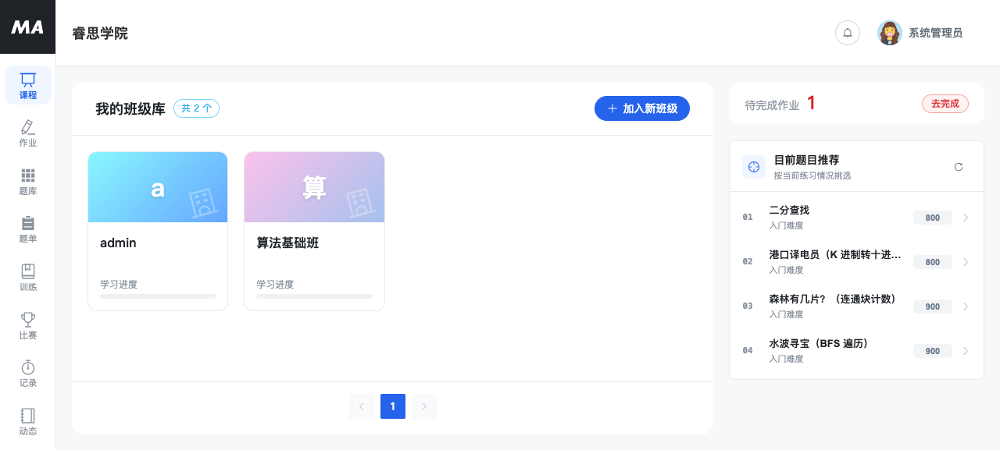
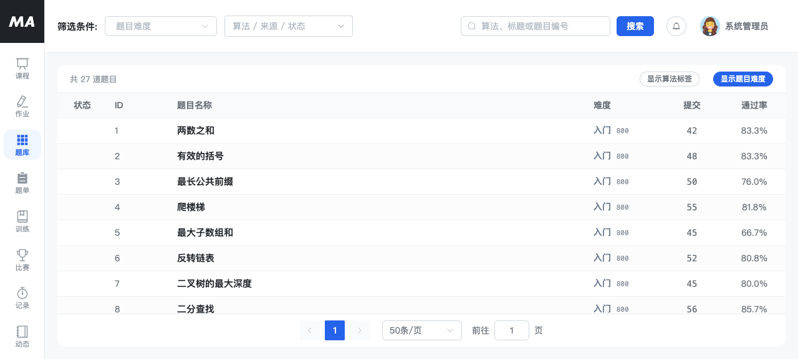
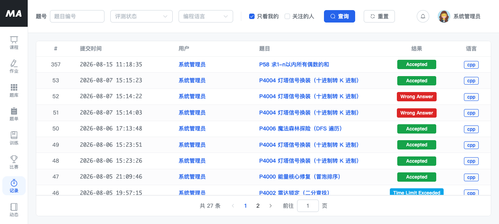

# MuseAlgo-OJ

**面向信息学奥赛（OI）教学场景的自托管在线判题系统** —— 题库 · 判题 · 比赛 · 班级教学 · 社区 · AI 助教。

[](LICENSE)
[](https://github.com/RasVz/MuseAlgo-OJ/actions/workflows/build.yml)
[](https://adoptium.net/)
[](https://spring.io/projects/spring-boot)
[](https://vuejs.org/)

---

## 简介

MuseAlgo-OJ 是一套面向**信息学奥赛教学**的自托管在线判题系统。除了常规 OJ 的题库与判题能力，它把"老师带班上课"这条主线做进了系统里：班级管理、课件下发、AI 助教答疑、学情统计与家长报告，都在同一个后台闭环。

系统自带判题调度、查重（抄袭检测）、OI 赛制与 subtask 部分分、考试与题单等功能。开发栈用 Docker Compose 一条命令启动，判题机与可选中间件按需追加 profile。

> 本项目主要服务于教学场景（K-12 竞赛训练），不追求高并发商业 OJ 的性能指标，更关注"老师能不能省事、学生能不能练到"。

## 界面预览

**我的班级库** —— 教师视角的班级总览：班级卡片、待完成作业、按当前练习情况推荐的题目。



**题库** —— 按算法标签、难度、来源与掌握状态筛选。



**提交记录** —— 判题结果（AC / WA / TLE 等）、编程语言与提交时间。



## 核心功能

| 模块 | 能力 |
|---|---|
| **题库与判题** | 支持多种语言的题目管理、测试用例、样例、题解；单题/批量导入（XML / FPS / ZIP） |
| **比赛** | 支持 ACM 与 **OI 赛制 + subtask 部分分**；赛中实时榜单、赛后自动查重与重测 |
| **班级教学** | 建班、拉学生、按班下发题单与课件、作业与进度跟踪 |
| **课件系统** | 基于 [Slidev](https://sli.dev/) 生成课件，在线 iframe 预览与下发 |
| **AI 助教** | 接入大模型（默认 DeepSeek）提供题目讲解、代码诊断、提示；支持流式输出与 RAG 检索增强 |
| **社区** | 帖子、评论、点赞、关注，题目与帖子互相关联 |
| **学情分析** | 提交统计、能力雷达、学生画像快照、家长报告导出 |
| **管理后台** | 用户/角色/权限（RBAC）、题目与比赛管理、内容治理、系统配置与提示词模板 |
| **代码查重** | 提交代码相似度检测与查重报告 |

## 技术栈

**后端**　Java 17 · Spring Boot 3.3 · MyBatis-Plus · MySQL 8 · Redis · RabbitMQ（可选）· Meilisearch（可选）· Flyway
**判题**　[Judge0](https://github.com/judge0/judge0) 1.13.1（通过 HTTP 调用）
**前端**　Vue 3.5 · Vite 7 · Element Plus · Pinia · ECharts · Monaco Editor
**课件**　Slidev
**编排**　Docker Compose

## 仓库结构

```
MuseAlgo-OJ/
├── OJ-backend/         # Spring Boot 多模块后端（12 个 Maven 模块）
│   ├── oj-admin/       #   启动模块（Spring Boot 入口 + Flyway 迁移）
│   ├── oj-api/         #   跨模块接口与 DTO 契约
│   ├── oj-system/      #   用户 / 角色 / 权限
│   ├── oj-problem/     #   题库、题面、测试用例
│   ├── oj-judge/       #   判题调度、提交记录、查重
│   ├── oj-contest/     #   比赛与榜单
│   ├── oj-community/   #   社区
│   ├── oj-teaching/    #   班级、课件、教学
│   ├── oj-ai/          #   AI 教学助手
│   ├── oj-analytics/   #   学情统计
│   ├── oj-framework/   #   基础配置 / 安全 / JWT
│   ├── oj-common/      #   通用工具与常量
│   └── db/             #   建表快照与演示种子数据
├── OJ-frontend/        # 学生 / 教师主站（Vue 3 + Vite）
├── OJ-Slidev/          # Slidev 课件工程
├── docker/             # 容器辅助配置（Maven 镜像、Judge0 配置、数据库初始化目录）
├── deploy/             # 生产部署产物（后端 / 前端 Dockerfile、Nginx 配置）
├── docs/               # 项目文档（架构 / 开发 / 部署 / 排错）
├── scripts/            # 开发脚本
├── compose.dev.yml     # 一键启动开发栈（源码挂载，热更新）
├── docker-compose.prod.yml  # 生产编排（发行镜像 + Nginx，见 docs/DEPLOYMENT.md）
└── .env.example        # 环境变量模板
```

## 快速开始（Docker，推荐）

**前置条件**：Docker Desktop。建议把资源上限调到 **4 CPU / 4 GB** 以上，否则 4 个容器加上 Maven 编译会明显卡顿。

```bash
git clone https://github.com/RasVz/MuseAlgo-OJ.git
cd MuseAlgo-OJ

cp .env.example .env
# 至少填一个 JWT_SECRET（否则后端启动即失败）：
#   openssl rand -base64 48

docker compose -f compose.dev.yml up -d
```

首次启动时 MySQL 会自动执行 `docker/mysql-init/00-schema.sql` 建立全部表结构与 Flyway 迁移历史（约十几秒），随后后端启动并通过 Flyway 校验。整个过程通常一两分钟。

**访问入口**

| 入口 | 地址 |
|---|---|
| 前端 | http://localhost:5173 |
| 后端 API | http://localhost:8080 |
| **接口文档（Knife4j）** | http://localhost:8080/doc.html |
| 健康检查 | http://localhost:8080/actuator/health |

**导入演示数据**（可选，给出演示账号、示例题目、班级与判题用例）

```bash
./scripts/db-seed.sh
```

导入后即可用以下账号登录（**仅供本地开发，切勿带入生产环境**）：

| 账号 | 口令 | 角色 |
|---|---|---|
| `admin` | `123456` | 系统管理员 |
| `teacher01` | `123456` | 教师 |

> 不执行这一步时库中没有任何账号：可自行到 `/register` 注册，或手动创建一个管理员后再从后台添加用户。

演示题目共 15 道，题面与判题用例都是**本项目原创编写**的（不对应也不取自任何第三方题库），
因此开箱即可提交代码、真实判题。用例文件在 `OJ-backend/db/demo-testcases/`，
由上面的脚本一并安装到 `OJ-backend/data/testcases/`——**不要只执行 `seed.sql`**，
否则库里只有路径、盘上没有文件，判题会失败。

**启动判题机**（默认不启动，镜像较大约 14 GB）

```bash
docker compose -f compose.dev.yml --profile judge up -d
```

**按需追加可选组件**

```bash
docker compose -f compose.dev.yml --profile extras up -d   # Meilisearch + RabbitMQ
docker compose -f compose.dev.yml --profile "*"    up -d   # 全部
```

`extras` 只启动中间件。要启用全文检索或消息事件，还需在本地 Compose 配置中将相应的
`OJ_SEARCH_ENABLED` / `OJ_RABBITMQ_ENABLED` 改为 `true`，核对连接参数后重新创建后端容器
（`docker compose -f compose.dev.yml up -d backend`）。只修改 `.env` 不会覆盖 Compose 中显式的 `false`。

**常用命令**

```bash
docker compose -f compose.dev.yml ps                 # 查看状态
docker compose -f compose.dev.yml logs -f backend    # 跟踪后端日志
docker compose -f compose.dev.yml restart backend    # 改后端代码后重启
docker compose -f compose.dev.yml down               # 停止（保留数据）
docker compose -f compose.dev.yml down -v            # 停止并清空数据卷
```

> 前端代码改动由 Vite HMR 即时生效，无需重启容器。

### 端口分配

| 服务 | 宿主端口 | 说明 |
|---|---|---|
| 前端（Vite） | 5173 | |
| 后端 | 8080 | |
| MySQL | 3307 | 刻意避开宿主原生 3306 |
| Redis | 6381 | 刻意避开宿主原生 6379 |
| Judge0 | 2358 | 仅 `judge` 分组 |
| Meilisearch | 7700 | 仅 `extras` 分组 |
| RabbitMQ | 5672 / 15672 | 仅 `extras` 分组 |

## 配置说明

所有敏感配置均通过环境变量注入，**仓库内不存放任何密钥**。复制 `.env.example` 为 `.env` 后填写：

| 变量 | 必填 | 说明 |
|---|---|---|
| `JWT_SECRET` | ✅ | JWT 签名密钥，≥32 字节随机串。缺失或过短后端启动即失败 |
| `OJ_DB_PASS` | ✅ | 数据库口令。产品部署必填（开发栈由 compose 固定为 `123456`） |
| `DEEPSEEK_API_KEY` | ⭕ | AI 助教密钥。缺失时 AI 功能自动降级，其余功能不受影响 |
| `DEEPSEEK_API_URL` | ⭕ | 兼容 OpenAI 格式的接口地址，不设置则用内置默认值 |
| `AI_MODEL` | ⭕ | 模型名，不设置则用内置默认值 |
| `COS_SECRET_ID` / `COS_SECRET_KEY` | ⭕ | 对象存储，用于头像与报告文件。不配置时自动降级为本地磁盘存储（`/uploads/`） |
| `OJ_PUBLIC_BASE_URL` | ⭕ | 同源部署显式设为空以返回 `/uploads/...`；两份 Compose 已覆盖为空，原生启动未设置时默认 `http://localhost:8080` |

> ⚠️ 可选配置请**整行注释掉**，不要写成 `AI_MODEL=` 这样的空赋值——
> 空字符串会覆盖 `application.yml` 里的默认值。`OJ_PUBLIC_BASE_URL=` 是同源部署所需的显式空值，属于例外。完整变量清单与默认值见
> `OJ-backend/oj-admin/src/main/resources/application.yml`。

## 生产部署

开发栈跑的是「容器内 Maven + Vite dev server」，**不适合上线**。生产用独立的编排与镜像：

```bash
# 1. 构建发行镜像（构建上下文必须是仓库根目录）
docker build -f deploy/Dockerfile.backend  -t musealgo-oj/backend:latest  .
docker build -f deploy/Dockerfile.frontend -t musealgo-oj/frontend:latest .

# 2. 准备密钥
cp .env.example .env && vi .env      # 填 JWT_SECRET 与 OJ_DB_PASS
chmod 600 .env

# 3. 启动（前端 Nginx 托管静态产物，/api 反代后端；MySQL/Redis 不对外暴露端口）
docker compose -f docker-compose.prod.yml up -d
curl -fsS localhost:8080/actuator/health     # 期望 {"status":"UP"}
```

生产编排与开发编排使用不同项目名（`musealgo-prod` / `musealgo-dev`），数据卷互不干扰。判题机 Judge0 需要 `privileged` 权限，单独部署后用 `JUDGE0_URLS` 接入。

完整说明（systemd 方案、Nginx、密钥轮换、升级回滚、上线检查清单）见 [docs/DEPLOYMENT.md](docs/DEPLOYMENT.md)。

## 本地开发（不使用 Docker）

需要自行准备 **JDK 17**、**MySQL 8**、**Redis**、**Node.js 22.12+**；Maven 可使用仓库包装器。
先按 [开发指南](docs/DEVELOPMENT.md#路线-b本地原生) 初始化数据库和 `.env`。以下命令均从仓库根目录执行。

```bash
# 终端一：后端（加载 .env，先安装模块，再启动服务）
./scripts/run-local.sh
```

```bash
# 终端二：前端（/api 与 /uploads 默认代理到 http://localhost:8080）
(cd OJ-frontend && npm ci && npm run dev)
```

手动启动后端时，安装阶段使用 `-am`，启动阶段不加 `-am`；完整命令见开发指南。

## 文档

| 文档 | 内容 |
|---|---|
| [docs/ARCHITECTURE.md](docs/ARCHITECTURE.md) | 系统架构：模块划分、依赖约束、判题链路、降级设计 |
| [docs/DEVELOPMENT.md](docs/DEVELOPMENT.md) | 开发指南：环境搭建、**数据库迁移机制**、如何加接口 / 迁移 / 页面 |
| [docs/DEPLOYMENT.md](docs/DEPLOYMENT.md) | 生产部署：Compose / systemd、Nginx、密钥管理、上线检查清单 |
| [docs/TROUBLESHOOTING.md](docs/TROUBLESHOOTING.md) | 常见问题与排错（启动失败、端口冲突、判题不返回、登录失败…） |

> 运行起来后，接口文档（Knife4j / OpenAPI 3）在 **http://localhost:8080/doc.html**。

## 第三方组件与许可

本项目在运行期依赖若干第三方组件，详见 [THIRD-PARTY-NOTICES.md](THIRD-PARTY-NOTICES.md)。

需要特别说明的是：[Judge0](https://github.com/judge0/judge0) 采用 **GPL-3.0** 许可。本项目通过 HTTP 调用独立部署的判题服务，不链接其代码；若你打算把 Judge0 的镜像或源码一并纳入自己的发行物，请自行评估并履行对应的 GPL 义务。

## 贡献

欢迎提交 Issue 与 Pull Request，请先阅读 [CONTRIBUTING.md](CONTRIBUTING.md)。
参与本项目即表示你同意遵守 [CODE_OF_CONDUCT.md](CODE_OF_CONDUCT.md)。

## 安全

请勿在 Issue 中公开安全漏洞。报告方式见 [SECURITY.md](SECURITY.md)。

## 许可证

[Apache License 2.0](LICENSE) © 2026 MuseAlgo-OJ
