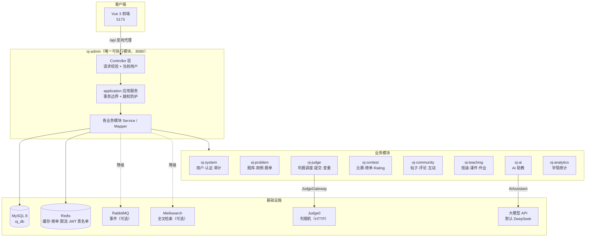
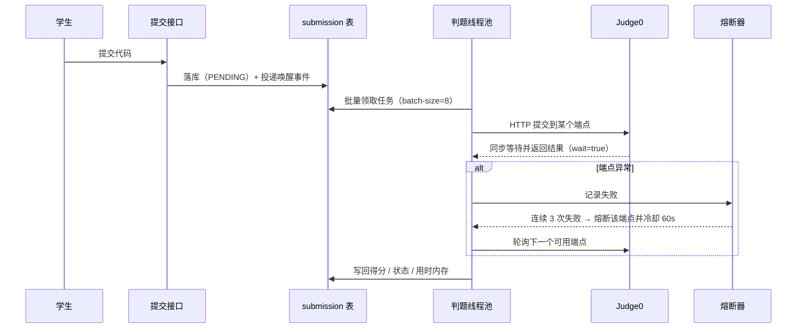

# 系统架构

> 本文面向希望读懂代码或参与二次开发的读者。若只是想跑起来，请看 [DEVELOPMENT.md](DEVELOPMENT.md)。

## 一、整体形态：模块化单体

MuseAlgo-OJ 是**一个 Spring Boot 可执行程序**，但代码按业务域拆成 12 个 Maven 模块。所有模块运行在同一进程、同一事务管理器、同一数据库连接池中，因此**不需要**微服务的注册中心、网关、分布式事务等基础设施。

这样做的取舍是：用模块边界换来了编译期可见的依赖约束（越界会被构建挡住），同时避免为教学场景引入不必要的运维复杂度。



**关键点**：判题机与 AI 供应商都藏在接口后面（`oj-api` 里的 `JudgeGateway`、`AiAssistant`），核心业务只依赖接口，因此可以替换供应商，也能在测试里注入 stub。

## 二、模块职责

| 模块 | 职责 |
|---|---|
| `oj-common` | 统一返回值、异常、注解、JWT 工具等无业务依赖的工具 |
| `oj-framework` | MyBatis-Plus、Redis、线程池、分页等基础设施配置 |
| `oj-api` | **跨业务域的稳定契约**：判题网关、AI 助教接口、跨模块只读查询 DTO |
| `oj-system` | 用户、认证、登录上下文、审计日志、文件上传 |
| `oj-teaching` | 班级、成员、课程、课件与 Slidev 构建 |
| `oj-problem` | 题目、测试用例、题单及题单题目关系 |
| `oj-judge` | 判题调度、提交记录、代码草稿、Judge0 适配、查重 |
| `oj-contest` | 比赛、参赛关系、比赛题目、排名与 Rating |
| `oj-community` | 帖子、评论、互动、收藏、关注 |
| `oj-ai` | AI 助教与模型供应商调用 |
| `oj-analytics` | 提交统计、能力雷达、学生画像、报告导出 |
| `oj-admin` | **唯一启动模块**：跨域组合 Controller、全局安全装配、定时任务、Flyway 迁移 |

## 三、依赖约束（重要）

`ModuleDependencyArchTest` 当前自动校验：`judge / analytics / teaching / contest / community / problem / ai`
不得依赖其他业务域（包括 `system`）的 `mapper / service / entity` 实现层包；
唯一目标白名单是认证主体 `top.everblue.oj.system.entity.User`。违反此规则会导致 `mvn test` 失败。

以下是开发与评审约定；其中禁止依赖 `oj-admin`、Controller 写操作分层尚未由该测试自动覆盖：

1. **业务模块不得依赖 `oj-admin`**。`oj-admin` 只负责装配，不承载实体与业务 Service。
2. **业务模块之间不得直接访问对方的 Mapper**。跨模块读取走 `oj-api` 中定义的只读 DTO 与查询接口；跨模块写操作走应用事件。
3. **Controller 不得直接调用 Mapper 或 `IService` 的通用写方法**。新增写操作必须落在模块内的 `top.everblue.oj.<module>.application` 应用服务里，由它负责：
   - 校验角色、资源归属与业务前置条件；
   - 组织事务边界；
   - 只复制允许客户端修改的字段（避免实体直接绑定造成越权更新）。

> 包名目前保持 `top.everblue.oj.*`，这是历史沿革，不影响模块划分。新增代码请按业务模块分层，不要再往根包放业务代码。

## 四、判题链路

判题是这套系统里最需要小心的一环，因为它涉及外部进程与超时。



几个设计要点：

- **多端点与熔断**：`judge0.urls` 支持逗号分隔的多个判题机地址，请求轮询分发；单个端点连续失败达阈值（默认 3 次）即熔断冷却（默认 60 秒），到期自动半开试探。这样一台判题机挂掉不会拖垮全站。
- **在途上限**：`judge0.max-inflight`（默认 4）必须 **≤ Judge0 的 worker 槽位数**。超过会让并发用例在 Judge0 队列里超时 → 重试 → 雪崩。
- **执行归属与结果事务**：每次领取递增 `attempt_count`；阶段更新、完成和失败均校验领取代次。最终结果、任务完成和 Outbox 在一个事务中提交，过期执行不能覆盖新一轮结果。
- **看门狗**：`oj.judge.watchdog` 定期扫描卡在 `PROCESSING` 的提交（默认 10 分钟阈值）并回收，用于兜住 Worker 崩溃或判题机挂起。
- **异步唤醒**：有 RabbitMQ 时通过消息队列毫秒级唤醒判题线程；没有 broker 时自动回退到纯数据库轮询，功能不受影响。

## 五、几个「可选组件自动降级」设计

项目刻意做到了**缺少可选中间件也能完整跑起来**，这对教学/自建场景很关键：

| 组件 | 缺失时的行为 |
|---|---|
| RabbitMQ | MQ仅加速判题与榜单通知；关闭或故障时判题任务轮询、数据库权威榜单及定时固化继续运行。重复消息不重复加分/Rating，详见 [验收规则](TESTING.md#计分与固化规则) |
| Meilisearch | `OJ_SEARCH_ENABLED=false` → 题目搜索回退 `LIKE` 查询；另有断路器，故障时自动短路降级 |
| 对象存储 COS | 未配置 → 走本地文件存储（`OJ_UPLOAD_DIR`） |
| 大模型 API | `DEEPSEEK_API_KEY` 为空 → AI 功能返回空结果并降级提示，**其余功能完全不受影响** |

## 六、认证与权限

- Access Token 仅用于请求认证，Refresh Token 仅用于续签；验证同时检查签名、有效期、用户名和用途。
- 登录成功签发 **JWT**；密钥由 `JWT_SECRET` 注入，**缺失或长度不足 32 字节时应用直接启动失败**（刻意快速失败，避免弱密钥被带上线）。
- 登出把 token 的 `jti` 写入 Redis 黑名单（键 `oj:jwt:blacklist:{jti}`，TTL 为 token 剩余有效期）。Redis 异常时采取 **fail-open** 策略——即判定为「未吊销」，保证可用性优先。
- 权限模型为 **RBAC**（用户 / 角色 / 权限），`oj.security.normalized-rbac` 可切换规范化实现。

题目详情与普通提交统一验证公开状态、所有者、已开放班级题单或比赛权限。对于当前用户有权限参加的进行中比赛，其比赛题必须通过比赛入口提交；其他班级的比赛不阻断公开题日常练习，避免绕过比赛结果可见性规则。列表响应不序列化标准答案；教师读取标准答案走专用受控接口。

班级课件写操作限制为本班教师或管理员，学生只能读取本班已显示的目录。Markdown 构建仅允许教师/管理员：大小不超过5MB，每个后端进程最多同时构建2份，`OJ_SLIDEV_BUILD_TIMEOUT_SECONDS`（对应 `oj.slidev.build-timeout-seconds`）默认120秒。课件作者仍需被视为可信内容提供者，构建进程尚未独立沙箱隔离。

## 七、可观测性

- Actuator 暴露 `health`、`info`、`prometheus` 三个端点；`/actuator/health` 适合做容器健康检查，`/actuator/prometheus` 可对接 Prometheus + Grafana。
- 生产控制台日志使用 **JSON 结构化输出**（Logstash encoder），便于日志平台采集。
- 接口文档由 **Knife4j（OpenAPI 3）** 提供，运行后访问 `/doc.html`。

## 八、数据库与迁移

- 迁移脚本位于 `OJ-backend/oj-admin/src/main/resources/db/migration`，由 Flyway 按版本号顺序执行，命名 `V{n}__说明.sql`。
- `baseline-on-migrate: true` + `baseline-version: 6`：这意味着 **V1–V6 属于「引入 Flyway 之前的既有基线」**，Flyway 只执行 V7 及之后的增量迁移。
- 因此**空库必须先有表结构基线**才能启动。仓库用 `docker/mysql-init/00-schema.sql`（纯结构 + Flyway 历史记录）承担这个角色，详见 [DEVELOPMENT.md](DEVELOPMENT.md) 的「数据库迁移」一节。
- ⚠️ **不要修改已有迁移文件**，哪怕只是改注释——注释及其他行内容也参与 Flyway checksum，修改可能让已有数据库在启动时报校验失败。

## 九、前端结构

`OJ-frontend` 是 Vue 3 + Vite 的单页应用，按业务域组织：

```
src/
├── api/          # 后端接口封装（axios）
├── components/   # 通用组件
├── router/       # 路由与权限守卫
├── stores/       # Pinia 状态
├── utils/        # 工具（请求拦截、埋点等）
└── views/        # 页面，按域分目录
    ├── auth/      登录 / 注册
    ├── home/      首页
    ├── problem/   题目详情与作答（Monaco 编辑器）
    ├── problem-list/ 题库
    ├── submission/   提交记录
    ├── contest/   比赛
    ├── class/     班级
    ├── study/     学习与题单
    ├── training/  训练
    ├── post/      社区
    ├── user/      个人主页
    ├── teacher/   教师工作台
    └── admin/     管理后台
```

开发期 Vite 把 `/api` 反向代理到后端（目标由 `VITE_PROXY_TARGET` 决定），因此前端代码里统一以 `/api` 为前缀，不需要关心后端地址。
