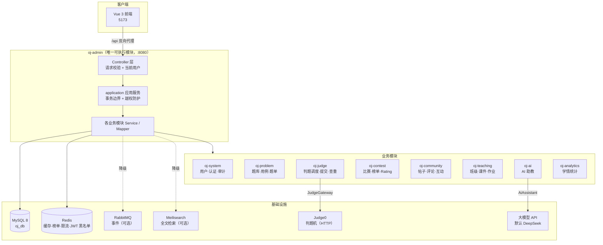
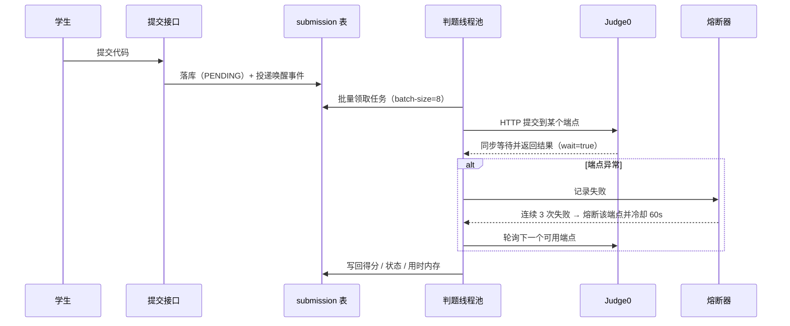

# 系统架构

> 本文面向希望读懂代码或参与二次开发的读者。若只是想跑起来，请看 [DEVELOPMENT.md](DEVELOPMENT.md)。

## 一、整体形态：模块化单体

MuseAlgo-OJ 是**一个 Spring Boot 可执行程序**，但代码按业务域拆成 12 个 Maven 模块。所有模块运行在同一进程、同一事务管理器、同一数据库连接池中，因此**不需要**微服务的注册中心、网关、分布式事务等基础设施。

这样做的取舍是：用模块边界换来了编译期可见的依赖约束（越界会被构建挡住），同时避免为教学场景引入不必要的运维复杂度。



**关键点**：判题机与 AI 供应商都藏在接口后面（`oj-api` 里的 `JudgeGateway`、`AiAssistant`），核心业务只依赖接口，因此可以替换供应商，也能在测试里注入 stub。

## 二、模块职责

| 模块 | 职责 |
|---|---|
| `oj-common` | 统一返回值、异常、注解、JWT 工具等无业务依赖的工具 |
| `oj-framework` | MyBatis-Plus、Redis、线程池、分页等基础设施配置 |
| `oj-api` | **跨业务域的稳定契约**：判题网关、AI 助教接口、跨模块只读查询 DTO |
| `oj-system` | 用户、认证、登录上下文、审计日志、文件上传 |
| `oj-teaching` | 班级、成员、课程、课件与 Slidev 构建 |
| `oj-problem` | 题目、测试用例、题单及题单题目关系 |
| `oj-judge` | 判题调度、提交记录、代码草稿、Judge0 适配、查重 |
| `oj-contest` | 比赛、参赛关系、比赛题目、排名与 Rating |
| `oj-community` | 帖子、评论、互动、收藏、关注 |
| `oj-ai` | AI 助教与模型供应商调用 |
| `oj-analytics` | 提交统计、能力雷达、学生画像、报告导出 |
| `oj-admin` | **唯一启动模块**：跨域组合 Controller、全局安全装配、定时任务、Flyway 迁移 |

## 三、依赖约束（重要）

`ModuleDependencyArchTest` 当前自动校验：`judge / analytics / teaching / contest / community / problem / ai`
不得依赖其他业务域（包括 `system`）的 `mapper / service / entity` 实现层包；
唯一目标白名单是认证主体 `com.musealgo.oj.system.entity.User`。违反此规则会导致 `mvn test` 失败。

以下是开发与评审约定；其中禁止依赖 `oj-admin`、Controller 写操作分层尚未由该测试自动覆盖：

1. **业务模块不得依赖 `oj-admin`**。`oj-admin` 只负责装配，不承载实体与业务 Service。
2. **业务模块之间不得直接访问对方的 Mapper**。跨模块读取走 `oj-api` 中定义的只读 DTO 与查询接口；跨模块写操作走应用事件。
3. **Controller 不得直接调用 Mapper 或 `IService` 的通用写方法**。新增写操作必须落在模块内的 `com.musealgo.oj.<module>.application` 应用服务里，由它负责：
   - 校验角色、资源归属与业务前置条件；
   - 组织事务边界；
   - 只复制允许客户端修改的字段（避免实体直接绑定造成越权更新）。

> Java 根包为 `com.musealgo.oj`，Maven `groupId` 为 `com.musealgo`。新增代码请按业务模块分层，不要再往根包放业务代码。

## 四、判题链路

判题是这套系统里最需要小心的一环，因为它涉及外部进程与超时。



几个设计要点：

- **多端点与熔断**：`judge0.urls` 支持逗号分隔的多个判题机地址，请求轮询分发；单个端点连续失败达阈值（默认 3 次）即熔断冷却（默认 60 秒），到期自动半开试探。这样一台判题机挂掉不会拖垮全站。
- **在途上限**：`judge0.max-inflight`（默认 4）必须 **≤ Judge0 的 worker 槽位数**。超过会让并发用例在 Judge0 队列里超时 → 重试 → 雪崩。
- **执行归属与结果事务**：`generation` 标识结果写入归属、`attempt_count` 计重试预算；阶段更新、完成和失败均校验 generation 与领取凭证。最终结果、任务完成和 Outbox 在一个事务中提交，过期执行不能覆盖新一轮结果。
- **看门狗**：`oj.judge.watchdog` 定期扫描卡在 `PROCESSING` 的提交（默认 10 分钟阈值）并回收，用于兜住 Worker 崩溃或判题机挂起。
- **异步唤醒**：有 RabbitMQ 时通过消息队列毫秒级唤醒判题线程；没有 broker 时自动回退到纯数据库轮询，功能不受影响。

## 五、几个「可选组件自动降级」设计

项目刻意做到了**缺少可选中间件也能完整跑起来**，这对教学/自建场景很关键：

| 组件 | 缺失时的行为 |
|---|---|
| RabbitMQ | MQ仅加速判题与榜单通知；关闭或故障时判题任务轮询、数据库权威榜单及定时固化继续运行。重复消息不重复加分/Rating，详见 [验收规则](TESTING.md#计分与固化规则) |
| Meilisearch | `OJ_SEARCH_ENABLED=false` → 题目搜索回退 `LIKE` 查询；另有断路器，故障时自动短路降级 |
| 对象存储 COS | 未配置 → 走本地文件存储（`OJ_UPLOAD_DIR`） |
| 大模型 API | `DEEPSEEK_API_KEY` 为空 → AI 功能返回空结果并降级提示，**其余功能完全不受影响** |

## 六、认证与权限

- Access Token 仅用于请求认证，Refresh Token 仅用于续签；验证同时检查签名、有效期、用户名和用途。
- 登录成功签发 **JWT**；密钥由 `JWT_SECRET` 注入，**缺失或长度不足 32 字节时应用直接启动失败**（刻意快速失败，避免弱密钥被带上线）。
- 登出把 token 的 `jti` 写入 Redis 黑名单（键 `oj:jwt:blacklist:{jti}`，TTL 为 token 剩余有效期）。Redis 异常时采取 **fail-open** 策略——即判定为「未吊销」，保证可用性优先。
- 权限模型为 **RBAC**（用户 / 角色 / 权限），`oj.security.normalized-rbac` 可切换规范化实现。

### 规范化 RBAC（`oj.security.normalized-rbac`）

- **默认关闭**（`false`，即 legacy 语义）。默认值保持不变：切换授权来源属于行为变更，应由部署方显式开启，不做隐式迁移。
- **legacy（`false`）**：授权完全由 `user.role` 派生（`ROLE_STUDENT/ROLE_TEACHER/ROLE_ADMIN` 加各角色内置的权限码），**不读取** `sys_user_role` / `sys_role_permission`。既有库无需任何数据准备。
- **normalized（`true`）**：授权唯一来源是 `sys_user_role` → `sys_role_permission` → `sys_permission` 关联表，`user.role` 仅作为展示字段，不再参与授权判定。开启前必须完成一次性关联回填，否则既有账号会失去全部权限（见下条）。
- **缺映射 fail-closed**：normalized 下用户没有任何 `sys_user_role` 关联时，授权集合为空并打 `WARN` 日志；**不回退 legacy**。语义是「登录成功、但无任何授权」，受保护接口返回 403。**缺映射不等于管理员**：`user.role=3` 但关联为空的账号不会获得 `ROLE_ADMIN`。
- **撤权即时生效**：`JwtAuthenticationTokenFilter` 每个请求都用 token 中的用户名回查数据库重新加载授权，因此停用账号、改角色、撤权限对**已签发的旧 JWT 在下一次请求即生效**，无需等待 token 过期。
- **管理员例外**：管理员端点（`/admin/**`、`/actuator/**`、接口文档在非公开时）统一用 `hasRole('ADMIN')` 校验，即要求存在 `sys_user_role` → ADMIN 的关联；normalized 下不存在「`user.role=3` 自动当管理员」的例外路径。`judge:rejudge`、`report:generate`、`report:read` 只是 `sys_permission` 中的目录项，**当前没有运行时门禁**：重判由 `hasRole('ADMIN')` 把关，周报生成由 `hasAnyRole('ADMIN','TEACHER')` 与服务内的班级/学生归属校验把关。
- **两种模式的拒绝形态**：方法级 `@PreAuthorize` 拒绝 = HTTP 403 + `body.code=403`（`SecurityAuthorizationExceptionHandler`）；服务内归属校验抛 `ForbiddenException` = HTTP 200 + `body.code=403`（`GlobalExceptionHandler` 统一保持 HTTP 200，业务码表达语义）。客户端判定必须同时看 HTTP 状态与 body 的 `code`。

题目详情与普通提交统一验证公开状态、所有者、已开放班级题单或比赛权限。对于当前用户有权限参加的进行中比赛，其比赛题必须通过比赛入口提交；其他班级的比赛不阻断公开题日常练习，避免绕过比赛结果可见性规则。列表响应不序列化标准答案；教师读取标准答案走专用受控接口。

班级课件写操作限制为本班教师或管理员，学生只能读取本班已显示的目录。Markdown 构建仅允许教师/管理员：大小不超过5MB，每个后端进程最多同时构建2份，`OJ_SLIDEV_BUILD_TIMEOUT_SECONDS`（对应 `oj.slidev.build-timeout-seconds`）默认120秒。课件作者仍需被视为可信内容提供者，构建进程尚未独立沙箱隔离。

## 七、可观测性

- Actuator 暴露 `health`、`info`、`prometheus` 三个端点；`/actuator/health` 适合做容器健康检查，`/actuator/prometheus` 可对接 Prometheus + Grafana。
- 生产控制台日志使用 **JSON 结构化输出**（Logstash encoder），便于日志平台采集。
- 接口文档由 **Knife4j（OpenAPI 3）** 提供，运行后访问 `/doc.html`。

## 八、数据库与迁移

- Flyway 迁移由 `oj-admin` 中的独立维护入口执行；版本文件与冻结、基线、开发启动和生产维护入口的规则统一见 [开发指南：数据库迁移](DEVELOPMENT.md#三数据库迁移必读)。
- 新装初始化由 MySQL 的 `00-schema.sql`（V53结构基线）和 `01-reference-roles.sql`（基础角色，不含账号）提供；生产 Compose 随后运行一次性迁移服务。日常检查、预览、备份、升级和恢复见[运维指南](OPERATIONS.md)。
- 开发应用的 Flyway 使用 `baseline-on-migrate=true` / `baseline-version=6`；生产独立维护入口使用 `baseline-on-migrate=false`，两者面向不同路径。开发入口在启动时自动校验并迁移；MySQL routine DDL不受过程内事务回滚影响，若迁移调用失败，routine可能残留。诊断步骤见[故障排查](TROUBLESHOOTING.md#v63角色初始化失败或留下存储过程)，发行镜像验证入口见[测试指南](TESTING.md#发行镜像演练)。空库必须先建立受支持的结构基线。
- 已执行或已分发的迁移及 `00-schema.sql` 必须保持原字节；注释也参与 Flyway checksum。迁移 SHA-256 清单是差异检查辅助材料，须结合可信 Git 历史评审，不能替代历史冻结规则。

## 九、前端结构

`OJ-Frontend` 是 Vue 3 + Vite 的单页应用，按业务域组织：

```
src/
├── api/          # 后端接口封装（axios）
├── components/   # 通用组件
├── router/       # 路由与权限守卫
├── stores/       # Pinia 状态
├── utils/        # 工具（请求拦截、埋点等）
└── views/        # 页面，按域分目录
    ├── auth/      登录 / 注册
    ├── home/      首页
    ├── problem/   题目详情与作答（Monaco 编辑器）
    ├── problem-list/ 题库
    ├── submission/   提交记录
    ├── contest/   比赛
    ├── class/     班级
    ├── study/     学习与题单
    ├── training/  训练
    ├── post/      社区
    ├── user/      个人主页
    ├── teacher/   教师工作台
    └── admin/     管理后台
```

开发期 Vite 把 `/api` 反向代理到后端（目标由 `VITE_PROXY_TARGET` 决定），因此前端代码里统一以 `/api` 为前缀，不需要关心后端地址。

## 十、报告任务生命周期

报告中心采用「受理与生成分离」：同一学生、班级和规范化周期只对应一个持久任务，状态为 `PENDING`、`GENERATING`、`GENERATED`、`FAILED`；退避等待仍是 `PENDING` + `nextAttemptAt`。受理接口只创建或复用任务并立即返回，报告仅由后台 worker 生成；没有取消 API。`attempts` 在持久 claim 时增加，自动重试与显式 retry 共用最多 3 次预算，重复请求不会增加预算或复活 `FAILED`。

worker 先在短事务中领取并持久化 attempt、generation、owner 和数据库时间 lease，再在事务外准备画像与 HTML。heartbeat 与 finalizer 只有在 job 状态、generation、owner 匹配且 lease 未过期时才可写回；过期 lease 的恢复使用反向 CAS/行锁取得恢复权。worker 重启后只按数据库状态与租约恢复，不在启动时无条件重置 `GENERATING`。成功 finalizer 在同一事务写 HTML、profile snapshot、`GENERATED`、站内交付、terminalRevision、attempt 成功状态和 READY 通知意图；失败 finalizer 在同一事务写 `FAILED`、terminalRevision、attempt 审计和 FAILED 通知意图。通知意图暂存失败时整体回滚。

claim、finish、retry、通知投递和读取都重新验证当前主体与班级/成员权限；worker 不依赖 HTTP SecurityContext。旧任务主体缺失、删除或失权时 fail-closed，不猜测当前班主任；有权限者可在预算内显式 retry 换绑。

报告中心可用、提醒已发、用户已读是三种独立事实：报告任务为 `GENERATED` 且 HTML 已持久化才算中心可用；`DELIVERED` 只表示通知意图已投递且同一事务创建了站内通知；已读状态只由站内通知维护。生成终态 `FAILED` 与通知投递 `FAILED` 分开持久化和展示。只有数据库短暂不可用、可确认的运行/依赖超时、finalizer 基础设施故障和派发容量不足进入三次预算的退避重试；未知渲染异常记录 `GENERATOR_ERROR`，可由有权限者显式 retry；确定性输入错误和空白输出为不可重试终态。失败只通过 `generationFailure` 返回安全错误码和摘要，不暴露堆栈或报告正文。

通知以持久 outbox 为事实来源，MQ 只用于唤醒，关闭 MQ 时数据库轮询仍推进。通知 worker 先在短事务提交 claim 与累计 attempt，再在另一短事务重新锁定任务与意图、校验代次和 lease、复核收件人权限与偏好并插入站内通知。首轮最多 5 次，管理员只可 redrive 一次，总预算 10 次且不清零已有 attempts；claim 后崩溃仍消耗一次预算。报告和通知更新按 job→intent 顺序加锁，避免 retry、dispatch 与 retention 的死锁。

报告任务 API 保留 Result wrapper：

| 方法与路由 | 行为 |
| --- | --- |
| `POST /profile/report/jobs` | 按 `studentId`、`classId`、`periodStart`、`periodEnd` 创建或复用任务；只受理，不等待渲染 |
| `GET /profile/report/jobs` | 按班级分页返回任务，列表不加载 HTML |
| `GET /profile/report/jobs/{jobId}` | 读取任务；仅 `GENERATED` 返回 HTML |
| `POST /profile/report/jobs/{jobId}/retry` | 对允许重试且预算未耗尽的 `FAILED` 任务显式重排 |
| `GET /profile/report/jobs/{jobId}/notification-status` | 返回当前访问者作为收件人的通知状态，不含其他收件人或报告内容 |

前端只在当前打开的详情轮询该任务，间隔 2 秒；使用单一递归定时器并跳过在途的相同 GET，不为列表行创建定时器。`PENDING`（含退避）与 `GENERATING` 显示为进行态；`FAILED` 显示安全错误码、attempts/预算，只有 `canRetry=true` 才提供重试；`GENERATED` 通过详情 GET 获取 HTML 后渲染 iframe，列表永不加载 HTML。关闭详情、路由离开或页面隐藏时立即停止轮询，恢复可见时重新读取服务端状态；详情或 HTML 收到 403 时清空 iframe 并停止轮询。报告 HTML 在受限 iframe 内运行，PNG 导出只复制经过白名单过滤的 HTML。

自动周报默认关闭；需要时由运维显式开启（周一 03:00 Asia/Shanghai，只入队，不等待生成），关闭不影响按需生成。留存默认 12 个月，清理时通知意图和站内通知由通知域一并移除，`student_profile_snapshot` 独立留存。升级报告结构按 V64（加列/新表）→ V65（索引）→ V66（回填）→ V68（留存索引）推进，不得跳段；升级前停止旧同步入口和旧 worker，旧 `GENERATING` 记录需显式开启 `report.worker.recover-legacy-generating` 后受控恢复。worker 进入 unhealthy 后按退出码 70 退出，由编排层重启；新 SPA 与后端必须同批升级。教师操作与配置边界见 [CONTEST-AND-REPORTS.md](CONTEST-AND-REPORTS.md) 和 [OPERATIONS.md](OPERATIONS.md)，验收入口见 [TESTING.md](TESTING.md#发行镜像演练)。
